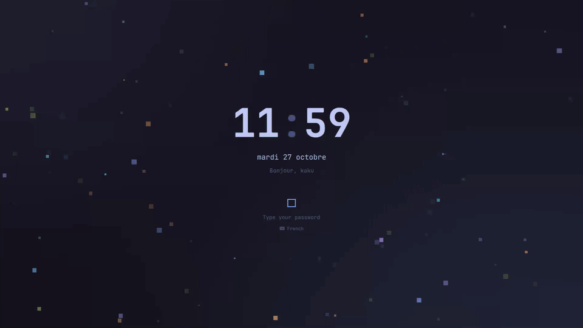
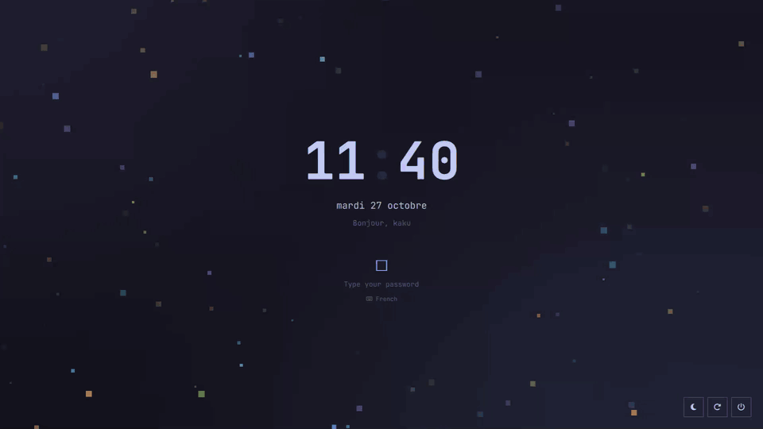
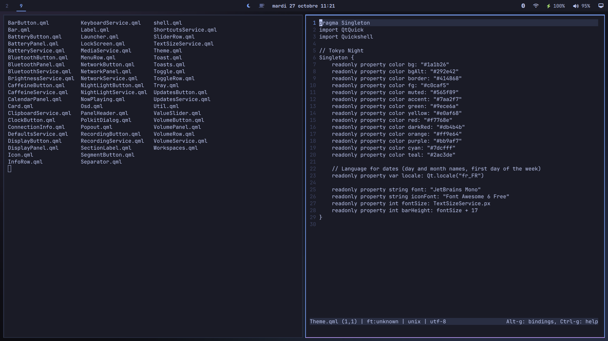
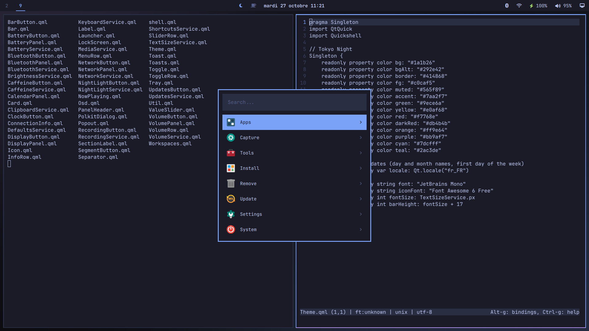
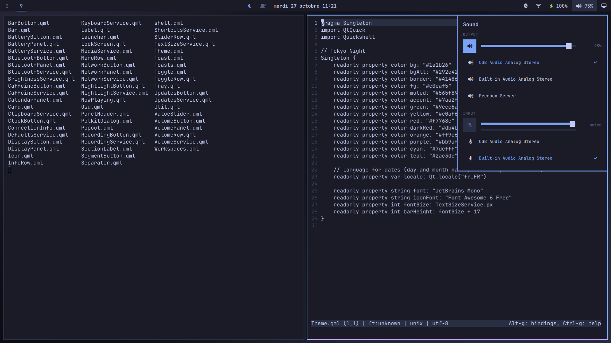
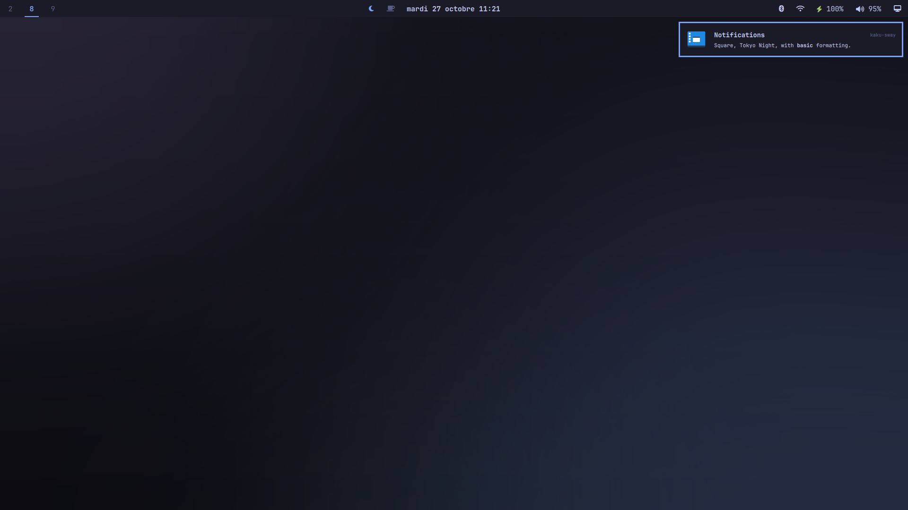
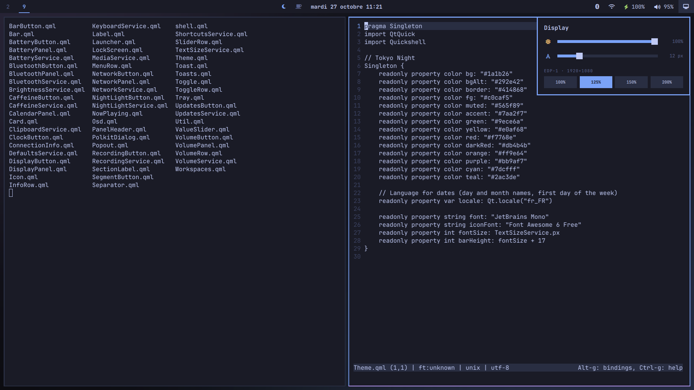
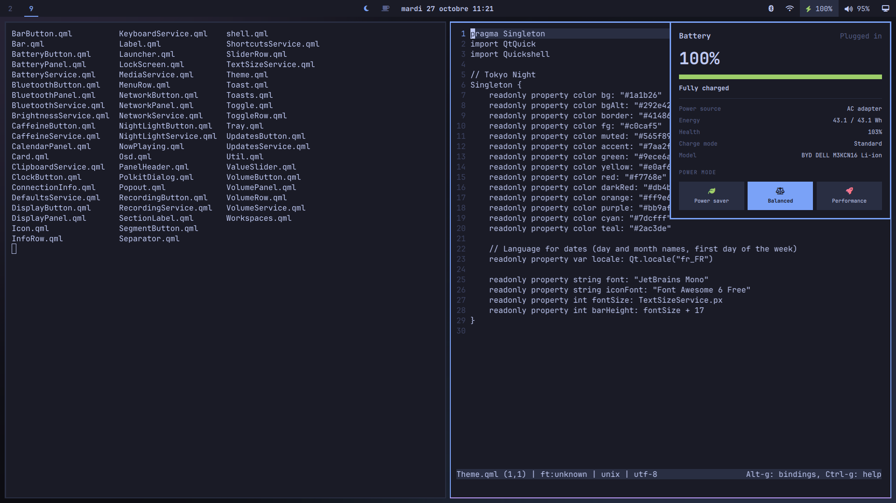
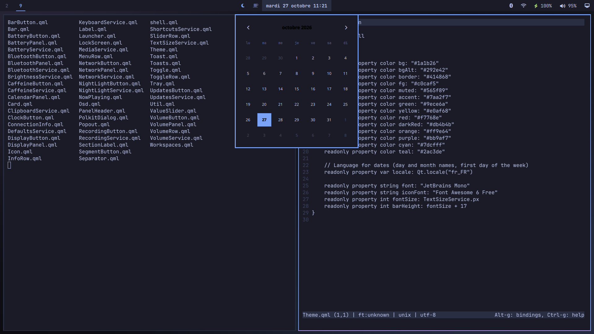
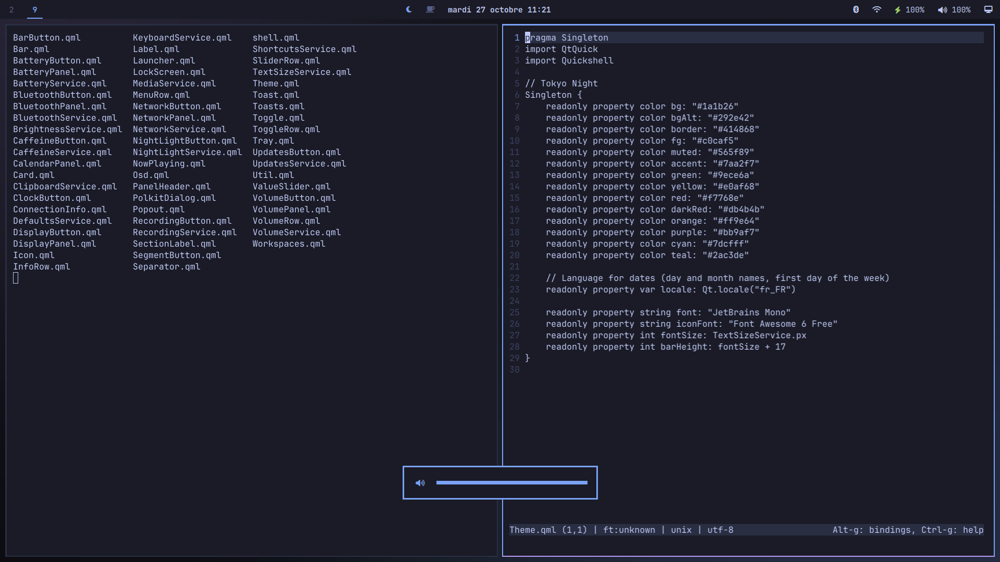

# kaku-sway

A Fedora Sway desktop built with [Quickshell](https://quickshell.org): Tokyo Night colors
and square corners everywhere (*kaku*, 角, is Japanese for "square / corner").

## What's in it

Everything below is QML in [`config/quickshell/`](config/quickshell), written for this
setup:

- **Bar**: workspaces, clock, tray, Bluetooth, network, battery, sound, display, night
  light, caffeine (no sleep), screen recording timer, pending updates, Claude and
  ChatGPT plan usage (if Claude Code / Codex is signed in).
- **Panels** that drop down from the bar: sound (devices, per-app volume, what's
  playing), network (Wi-Fi, connection details, live traffic), Bluetooth, display
  (brightness, text size, scale), battery (health, power modes), calendar, AI usage limits
  and when they reset.
- **Launcher** (Super+Space): apps, plus menus for screenshots and recording, tools
  (night light, keyboard shortcuts, calculator, clipboard history), installing and
  removing Fedora packages and Flathub apps, updates, default apps, power.
- **Notifications**, **volume / brightness / keyboard layout indicators**.
- **Lock screen** where little square spirits drift around, line up as you type your
  password, hold their breath while it's checked, and sulk when it's wrong. Password or
  fingerprint.
- **Admin password prompt** (polkit agent) in the same style.
- **Login screen** (SDDM theme) matching the lock screen.
- **Speech to text** (optional) with [voxtype](https://github.com/peteonrails/voxtype):
  hold Super+D, speak, let go, and the text is typed where the cursor is (the language
  is detected). Runs offline (NVIDIA Parakeet); your voice level shows on screen.
- Low battery warnings, automatic night light (sunset to sunrise), clipboard history.

| | |
| --- | --- |
|  |  |
|  |  |
|  |  |
|  |  |

## Install

On Fedora with the [Sway spin](https://fedoraproject.org/spins/sway/):

    git clone https://github.com/mickeiik/kaku-sway
    cd kaku-sway
    ./install.sh

It installs the packages in [`packages.txt`](packages.txt), copies the config files
into place (your existing ones are moved to `~/.config/kaku-backup-<date>` first), sets
up the login screen, enables fingerprint login and lockout after 3 wrong passwords
(faillock), and sets the GTK theme. Log out and back in afterwards.

It first asks whether to add speech to text (or pass `--dictation` / `--no-dictation`).
That's voxtype, from its GitHub releases (it isn't in Fedora's), and its ~2.6 GB speech
model; it keeps about 2 GB of memory while running. Its updates then come with the
rest, in the launcher's Update.

The keyboard is French AZERTY with US as second layout (Alt+Shift switches): change
`xkb_layout` in `config/sway/config.d/10-input.conf` for yours. Dates are in French
(`locale` in `config/quickshell/Theme.qml`).

## Keys

| Keys | |
| --- | --- |
| Super+Space | launcher |
| Super+Return | terminal (foot) |
| Super+Shift+B / Super+Alt+B | browser / private window |
| Super+W | close window |
| Super+F | fullscreen |
| Super+Shift+Space | floating on/off |
| Super+R | resize mode |
| Super+S / Super+Shift+S | scratchpad: show / send window there |
| Super+1…0 / Super+Shift+1…0 | workspace / move window there (AZERTY keys work) |
| Super+C / Super+V | copy / paste in any app, terminals included |
| Ctrl+Super+V | clipboard history |
| Super+D (hold) | dictate, if installed: speak, let go to type it (Esc cancels) |
| Print / Alt+Print / Ctrl+Print | screenshot: area / window / screen |
| Alt+Shift | switch keyboard layout |

Windows tile automatically ([autotiling](https://github.com/nwg-piotr/autotiling)).

## Layout

| Path | |
| --- | --- |
| `config/sway/` | Sway config; `config.d/` files replace Fedora's drop-ins of the same name |
| `config/quickshell/` | the shell (`shell.qml` is the entry point) |
| `config/sddm-theme/` | login screen |
| `config/voxtype/` | speech to text (model, language) |
| `config/gtk-3.0`, `gtk-4.0`, `foot`, `micro`, `swappy` | app theming |
| `config/systemd/` | runs voxtype's Parakeet build |
| `bin/` | `lock-screen` (Quickshell lock with swaylock fallback), `launcher-pkg` (package browsers, voxtype updates), `voxtype-onnx` (voxtype's Parakeet build) |

## License

[MIT](LICENSE)
